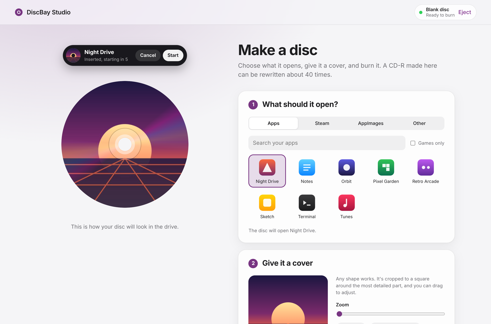
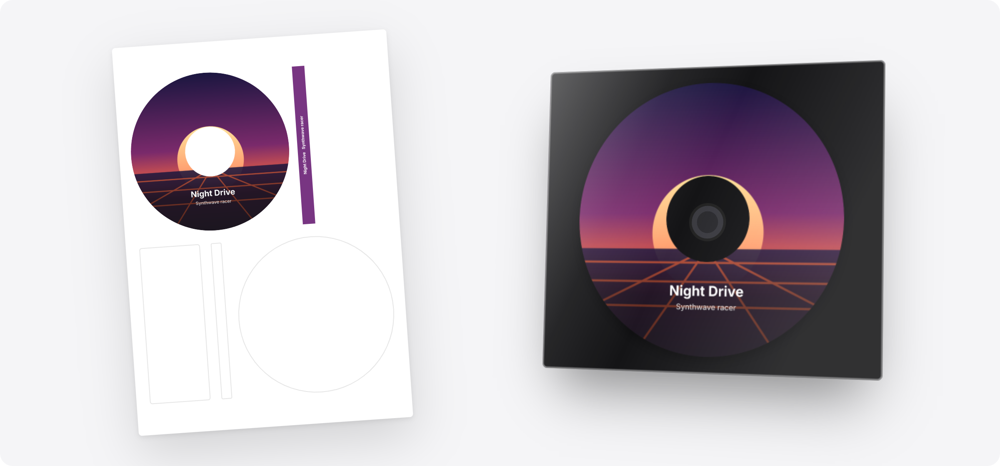

<div align="center">

<picture>
  <source media="(prefers-color-scheme: dark)" srcset="docs/media/hero-dark.svg">
  
</picture>

<br>
<br>

# DiscBay

Slide in a disc. Hear it spin up. Your game starts.

A console-style disc launcher for Linux.

<br>

<a href="#install"><picture><source media="(prefers-color-scheme: dark)" srcset="docs/media/buttons/get-started-dark.svg"></picture></a>
&nbsp;
<a href="https://blog.jolen.me/post/a-fun-way-to-launch-your-games"><picture><source media="(prefers-color-scheme: dark)" srcset="docs/media/buttons/read-the-story-dark.svg"></picture></a>

<br>
<br>
<br>

A notification slides down, counts to five and opens the game.<br>
Pull the disc out and it closes, like a cartridge.<br>
The disc holds no software, only which installed app to open.

<br>
<br>
<br>

## Make a disc

Pick an app, drop in a cover, burn.<br>
One CD-R can be rewritten about 40 times.

<br>

<picture>
  <source media="(prefers-color-scheme: dark)" srcset="docs/media/studio-dark.png">
  
</picture>

<br>
<br>
<br>

## Print a label

Disc faces and case spines for standard A4 label sheets.<br>
In a clear slim case, the disc is the cover.

<br>



<br>
<br>
<br>

## Install

</div>

<details open>
<summary><b>&nbsp;Fedora</b></summary>
<br>

```sh
sudo dnf copr enable jolen/discbay
sudo dnf install discbay
```

Log out and back in, and DiscBay is running.

<br>
</details>

<details>
<summary><b>&nbsp;Other distributions</b></summary>
<br>

Not packaged yet. DiscBay needs Python 3.11+, PyGObject, GTK 4 with
gtk4-layer-shell, Flask and xorriso. Install those, then clone this
repository and run `./install.sh`. If you get it running on your distro,
open an issue with the package names so it can get its own section here.

<br>
</details>

<br>

<div align="center">

Then open Studio and make your first disc.

<br>

<a href="http://localhost:8404"><picture><source media="(prefers-color-scheme: dark)" srcset="docs/media/buttons/open-studio-dark.svg"></picture></a>

<br>
<br>
<br>
<br>

<a href="docs/GUIDE.md"><picture><source media="(prefers-color-scheme: dark)" srcset="docs/media/buttons/guide-dark.svg"></picture></a>
&nbsp;
<a href="docs/PROTOCOL.md"><picture><source media="(prefers-color-scheme: dark)" srcset="docs/media/buttons/frontend-dark.svg"></picture></a>
&nbsp;
<a href="https://github.com/jolenjolen/discbay/issues"><picture><source media="(prefers-color-scheme: dark)" srcset="docs/media/buttons/issue-dark.svg"></picture></a>

<br>
<br>
<br>

<sub>Free software under the <a href="LICENSE">GPL-3.0</a>. Made by <a href="https://blog.jolen.me">Jolen</a>.</sub>

</div>
